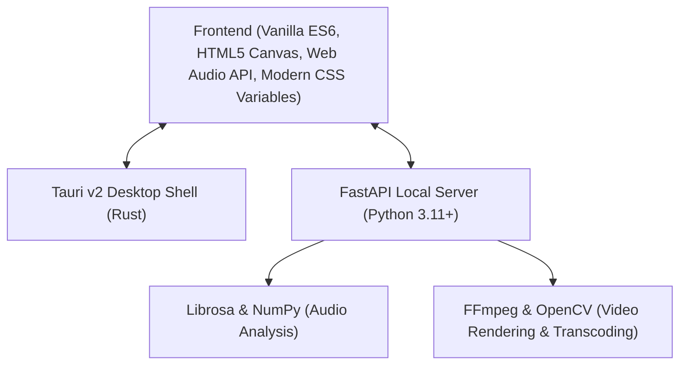

# ⚡ STRANGELET STITCH

> **The Esoteric, Audio-Reactive AI Montage & Music Video Synthesis Engine.**  
> *Autonomous Energy-Arc Sequencing · Dual-Player Ping-Pong Buffering · Hardware Visual Shaders · Kinetic Subtitles*

---

[](https://tauri.app/)
[](https://fastapi.tiangolo.com/)
[](https://developer.mozilla.org/en-US/docs/Web/API/Web_Audio_API)
[](LICENSE)

---

## 🎬 What is Strangelet Stitch?

**Strangelet Stitch** is a hybrid desktop workstation and automated music video synthesis engine. Built on a zero-latency **Tauri + FastAPI + Web Audio + Canvas** stack, it deconstructs loaded audio tracks into transients, downbeats, BPM tempos, and musical sections—then algorithmically splices video clips, still-image Ken Burns motion sequences, and typographic lyrics into hypnotic, tempo-locked montages.

Whether you're crafting high-octane 90s MTV grunge cuts, hypnotic ambient slow burns, or vertical TikTok/Reel lyric visualizers, Strangelet Stitch gives you the power of algorithmic generative editing with granular non-linear workbench control.

---

## ✨ Key Features

### 🎵 1. Deep Audio-Reactive Intelligence
- **Multi-Stem Transient Decomposition**: Librosa-powered stem analysis for kicks, snares, downbeats, and harmonic energy peaks.
- **Dynamic Energy-Arc Story Spine**: Automatically identifies song structure (*Intro, Verse, Chorus, Bridge, Breakdown, Outro*) and adapts cut pacing dynamically.
- **Non-Destructive Web Audio Slice FX**: Right-click directly onto the waveform to apply real-time DSP slice effects:
  - `↺ REV ♫` Reverse Audio Slice
  - `⚡ CHOP` Beat Stutter / Repeat chop
  - `🐢 0.5x` Half-Speed Tape Stop
  - `🔇 MUTE` Drop-Out Silence

### 🔀 2. Dual Workflow Modes
- **⚡ PRESET (AUTO SPINE)**: Fully autonomous generative montage generation. The Story Spine engine selects media, calculates Fibonacci cut rhythms, and arranges transitions without manual intervention.
- **✂ MANUAL (WORKBENCH)**: Freeform non-linear editing track. Unlocks manual clip dragging, edge trimming, cursor splitting (`S`), copy/paste (`Ctrl+C` / `Ctrl+V`), clip reversal (`REV`), and speed multipliers (`0.5x`, `1.0x`, `2.0x`).

### 🚀 3. Stutter-Free Dual-Player Ping-Pong Engine
- Uses dual offscreen video elements (`playerA` and `playerB`) operating in a ping-pong buffer pool.
- While the active player renders to the viewport canvas, the standby player background-preloads and seeks the upcoming timeline block.
- Zero-latency instantaneous swapping at cut timestamps with a **Frame-Drop Failsafe** so video decode hitches never stall the Web Audio master clock.

### 🔮 4. Hardware Visual Shaders & Avant-Garde FX
Real-time GPU and canvas filter pipeline featuring 6 esoteric hardware aesthetics:
- 🟢 **CRT Phosphor**: Monochrome amber/green terminal tint, raster scanlines, phosphorescent bloom, and barrel distortion.
- 🎞️ **Bleach Bypass**: Silver Halide 90s film stock simulation with high-contrast desaturation.
- 🌡️ **Thermal Solarization**: False-color infrared mapping with difference blending and chromatic hue inversion.
- 📼 **VHS Tape Degrade**: Chroma displacement, tape jitter flutter, and authentic tracking lines.
- 📜 **Sepia Rotogravure**: 1920s film flicker, warm duotone mapping, and fluctuating exposure grain.
- ⚡ **RGB Split Strobe**: Dynamic chromatic aberration triggered on transient snare and hi-hat hits.
- **Auto-Vary FX Engine**: Generatively switches filters on song sections, 4-bar phrases, or chaotic transient spikes.

### ✂️ 5. Burroughs Cut-Up & Typographic Flash Engine
- Subliminal single-frame text injections inspired by William S. Burroughs and Brion Gysin's fold-in technique.
- Configurable text sources: Classic Cut-Up literature fragments, parsed song lyrics, custom sigils, or pure visual noise.
- Upper-third positioning scrim to prevent collisions with lower-third subtitles.

### 📝 6. Timed Lyrics & Subtitle Suite
- Direct import of `.lrc` and `.srt` subtitle files with millisecond offset tuning (`±5.0s`).
- Dynamic kinetic punch animations synchronized to lyric word onset.
- 10+ cult typography font choices (*VT323, Rubik Glitch, Cinzel Decorative, Major Mono, Special Elite*).

### 📐 7. Industry Video Templates & Multi-Resolution Export
- **Presets**: Cyberpunk Montage, 90s Grunge MTV, Minimalist Ambient, Avant-Garde Experimental, Hyper-Pop Strobe, and Lyric Showcase.
- **Output Formats**:
  - `4K UHD` (3840×2160)
  - `1080p Full HD` (1920×1080)
  - `720p Quick Draft` (1280×720)
  - `9:16 Vertical Reel` (1080×1920 for TikTok / Instagram / Shorts)
  - `1:1 Square` (1080×1080)
  - XML / EDL timeline exports for Premiere Pro and DaVinci Resolve.

---

## 🛠️ Architecture & Tech Stack



- **Frontend**: Zero-framework Vanilla ES6 JavaScript, HTML5 Canvas 2D, Web Audio API, CSS Custom Properties (`styles.css`).
- **Desktop Runtime**: [Tauri v2](https://tauri.app/) (lightweight, memory-efficient Rust desktop container).
- **Backend Service**: [FastAPI](https://fastapi.tiangolo.com/) + Uvicorn.
- **Audio Processing**: [Librosa](https://librosa.org/), SciPy, SoundFile.
- **Video Processing**: FFmpeg CLI pipeline with hardware acceleration (`h264_nvenc` / `videotoolbox` / `libx264`).

---

## 🚀 Quick Start Guide

### Prerequisites
1. **Node.js** (v18+ recommended)
2. **Python** (v3.10+ or v3.11+)
3. **FFmpeg** installed and accessible in your system `PATH`.
4. **Rust** (if compiling the desktop Tauri application).

### 1. Clone the Repository
```bash
git clone https://github.com/lordgriefo/strangelet-stitch.git
cd strangelet-stitch
```

### 2. Set Up the Python Environment
```bash
# Create virtual environment
python -m venv .venv

# Activate environment (Windows PowerShell)
.\.venv\Scripts\Activate.ps1
# (Or on macOS/Linux: source .venv/bin/activate)

# Install backend dependencies
pip install -r backend/requirements.txt
```

### 3. Launch in Browser / Local Mode
```bash
# Start backend server
npm start
# (Runs FastAPI on http://127.0.0.1:8765)

# Open frontend in your browser:
# Navigate to http://127.0.0.1:8765/ or serve the /frontend directory
```

### 4. Launch Desktop App (Tauri)
```bash
npm install
npm run tauri:dev
```

---

## ⌨️ Transport & Keyboard Shortcuts

| Shortcut | Action |
| :--- | :--- |
| <kbd>Space</kbd> | Play / Pause |
| <kbd>Esc</kbd> / <kbd>Num 0</kbd> | Stop & Rewind to Start |
| <kbd>Home</kbd> / <kbd>W</kbd> | Return to Zero (00:00.00) |
| <kbd>End</kbd> | Jump to Timeline End |
| <kbd>L</kbd> | Toggle Timeline Loop |
| <kbd>S</kbd> | Split Selected Video Block at Playhead |
| <kbd>Del</kbd> | Delete Selected Cut Block |
| <kbd>Ctrl</kbd> + <kbd>C</kbd> / <kbd>V</kbd> | Copy / Paste Cut Block |
| <kbd>Ctrl</kbd> + <kbd>N</kbd> | New Session (Clean Slate) |
| <kbd>Ctrl</kbd> + <kbd>O</kbd> | Open Saved Project Bundle |
| <kbd>Ctrl</kbd> + <kbd>S</kbd> | Save Project State |
| <kbd>Ctrl</kbd> + <kbd>E</kbd> | Open Render / Export Modal |
| <kbd>F5</kbd> | Load Demo Track & Media |

---

## 🎨 Customizing the Color Palette

All UI theme colors are consolidated into `:root` variables in [`frontend/styles.css`](frontend/styles.css). You can easily customize the studio theme by adjusting:

```css
:root {
  --bg-darkest: #090a0c;          /* Studio chassis & splash */
  --bg-dark: #101216;             /* Primary panels */
  --bg-medium: #171a21;           /* Sidebar bays & strips */
  --border-color: #262a35;        /* Subdued borders */

  --color-primary: #dc2626;       /* Crimson Red brand accent */
  --color-primary-hover: #ef4444; /* Hover states */
  --color-secondary: #2563eb;     /* Royal Blue mode toggles */
  --color-secondary-hover: #3b82f6;
}
```
Waveform canvas graphs and playhead indicators in `app.js` will automatically inherit your chosen colors with high-contrast luminance.

---

## 📜 License

Distributed under the **MIT License**. See `LICENSE` for details.

---

<p align="center">
  <i>"Language is a virus from outer space." — William S. Burroughs</i>
</p>
